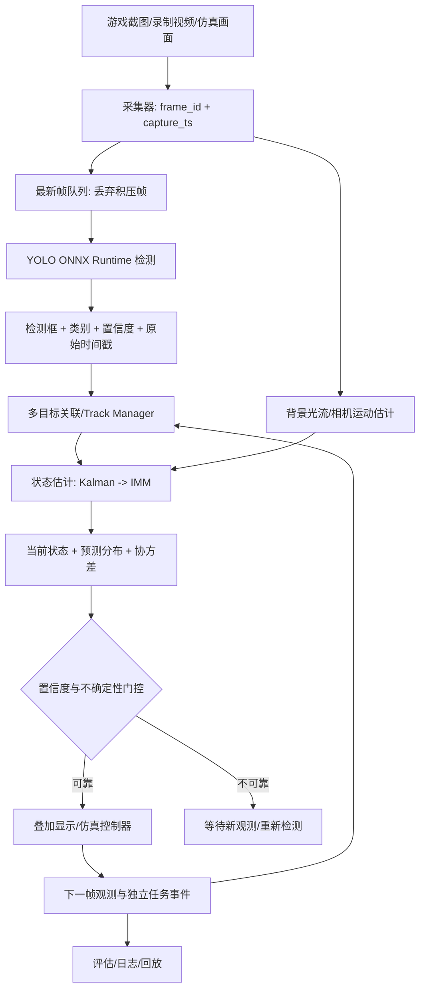

# FPS 视觉检测、目标跟踪与反馈系统工程设计方案 v2.0（Windows / NVIDIA TensorRT 官方 SDK）

> **2026-11-09 用户需求修订（当前优先基线）**：人负责寻找目标和大幅转动镜头；程序仅在中心附近的辅助区域内，对已选可靠目标进行受限的二维微调，人工主动转向时让步。区外不自动大幅追逐，不自动换人。旧章节的全自主闭环场景保留为算法诊断，不作为主产品成功条件。具体状态、参数、验收及交接见 [human-led-assist-handoff.md](human-led-assist-handoff.md) 与 openspec/changes/human-led-assist/；其与旧控制范围描述冲突时以本次修订为准。YOLO 监督训练与控制算法仿真验证分开，当前不训练自主镜头控制策略。

> 版本：v2.0（NVIDIA TensorRT 官方 SDK Windows 版） | 日期：2026-11-02 | 目标读者：Codex、C++ 工程师、模型训练工程师
>
> 使用边界：方案面向自建仿真、离线录像分析和获得授权的测试环境。在线游戏中的自动操作应遵守相关规则。本方案不包含规避反作弊或隐藏自动化行为的设计。

## 0. 执行摘要

建设一个可复现、可测试、可逐步演进的视觉系统：从截图/录像中检测 `person`、`head`，关联跨帧目标，补偿推理延迟和相机运动，估计当前及短期未来目标位置与不确定性；在自建仿真环境中测试视觉反馈控制，并用独立的任务结果信号评价效果。优先保证观测时间戳、数据一致性和失败恢复，而非追求单次预测“绝对准确”。

**核心链路**：原始画面 → 带时间戳的采集 → YOLO 检测（NVIDIA TensorRT SDK / TensorRT）→ 数据关联 → Kalman/IMM 状态估计 → 相机运动补偿 → 延迟预测 → 不确定性门控 → 可视化/仿真控制 → 新观测与结果反馈。

**第一版 MVP**：数据治理 + 统一标注 + YOLO 检测 + C++ NVIDIA TensorRT SDK + 时间戳 + 单/多目标 Kalman 跟踪 + 录像回放评估。**不应**将多模型融合、FAISS、PID、在线任务结果识别作为第一版阻塞项。

## 1. 背景、问题与目标

### 1.1 业务背景

既有数据以屏幕中心 `320×320` 截图为主。游戏人物可能远距离仅占几个至几十个像素；可能仅露出头部、被掩体遮挡、蹲下、突然变向或停止。YOLO 检测结果有采集/排队/推理延迟；鼠标输入与游戏画面响应存在另一条独立延迟链路。单纯将旧检测框当作当前坐标，或对每个误差直接做 PID，容易产生滞后、误关联、抖动、过冲。

### 1.2 功能目标

1. 在多场景下检测人物可见区域与头部，包含小目标、遮挡与无人物画面。
2. 维护稳定的目标轨迹 ID，输出当前状态、短期预测位置、时间戳和协方差。
3. 区分人物自身运动、姿态变化与镜头运动。
4. 通过新观测修正预测，明确异常、遮挡、丢失、重捕获行为。
5. 在自建测试环境中提供可观测的控制反馈及独立任务结果评价。
6. 为 Codex 提供可拆分、可验收的实现计划。

### 1.3 非目标

- 不保证不可预测的急停、变向、蹲下的未来轨迹必然正确。
- 不将图像嵌入或 FAISS 误认为目标检测器。
- 不通过单次截图或未出现命中特效推断任务必然失败。
- 不在没有可测量反馈的情况下宣称鼠标控制精度。

## 2. 总体架构



建议三个独立进程/子系统：`dataset-tools`（Python）、`model-training`（Python/Ultralytics）、`vision-runtime`（C++）；仿真控制与任务评价单独置于 `sim-harness`。进程间可先用文件/本地接口，避免初期引入复杂分布式组件。

## 3. 数据采集、分类和上下文

### 3.1 原始数据与裁剪策略

- **保留既有 320×320**：直接原分辨率裁剪时保留目标原有像素，适合中心小目标；不能通过放大恢复缺失的背景细节。
- **新增完整原始帧**：推荐无损 PNG 或质量受控的图像/视频帧，记录源分辨率、采集时间、录像片段、场景 ID。
- **派生裁剪**：从完整帧生成中心 `320×320`、`640×640`、`960×960`；根据检测目标可增加滑窗切片。`640×640` 是优先实验方案，不是已验证最优值。
- **裁剪坐标变换**：裁剪框左上角 `(ox,oy)`，原图坐标 `x_full=x_crop+ox, y_full=y_crop+oy`；如有 resize，先逆缩放和去 padding，再加偏移。
- **禁止数据泄漏**：同一原始帧的不同裁剪、相邻高度相似的连续帧必须分在同一 train/val/test 分组。

### 3.2 样本分类体系

| 维度 | 示例值 | 用途 |
|---|---|---|
| `sample_type` | positive / negative / hard_negative / uncertain | 样本管理 |
| `scene_id` | mapA_corridor_01 | 场景上下文 |
| `session_id` | recording_20261102_01 | 防泄漏分组 |
| `visibility` | full / upper_body / head_only / partial | 可见性属性 |
| `occlusion` | none / wall / cover / other | 遮挡统计 |
| `distance_bucket` | near / mid / far / tiny | 数据均衡，非真实米数 |
| `motion_tag` | static / moving / turning / stopping / crouching | 视频序列评估 |
| `camera_motion` | still / pan / fast_pan / unknown | 镜头运动分析 |
| `review_status` | draft / reviewed / approved / ignore | 标注质量控制 |

`scene_id`、`sample_type` 等是**数据元数据**，普通 YOLO 不会自动读取这些字段作为模型输入；它们用于抽样、评估、分组、排查误差。真正被 YOLO 学到的上下文来自输入图像的周围像素。

### 3.3 正负样本采集

同一场景尽量同时收集：有人完整出现、仅露头、从掩体出现/消失、人物完全离开、外观类似头部的背景物体、镜头转动、不同距离和光照。**真正无目标**的负样本不画框；**有目标但很难辨认**的样本不能直接标负样本，应标记 `uncertain/ignore` 供复核。困难负样本例如墙体纹理、装饰物、阴影、类似头盔的物体。

### 3.4 数据清洗

- 基于 SHA-256 去除字节重复；感知哈希/相似度去除过密重复帧，但保留有意义的姿态转变。
- 过滤黑屏、UI 遮挡严重、分辨率错误、坐标越界、标签不一致。
- 对 `tiny`、`head_only`、`hard_negative` 单独统计数量与质量。
- 按 `session_id` 或场景分组切分，建立 `in_scene` 与 `unseen_scene` 两套评估集。
- 保留数据集版本与不可变 manifest；训练模型关联数据集版本、配置和代码 commit。

### 3.5 推荐目录

```text
data/
  raw/{session_id}/frames/              # 不修改的原始帧
  manifests/frames.jsonl                 # 帧、场景、裁剪、时间戳
  annotations/source/                    # 原始标注文件
  derived/crops/{size}/                 # 320/640/960
  datasets/yolo_v001/{images,labels}/{train,val,test}/
  splits/v001.json
  reports/quality_v001.json
```

示例 manifest（每行一个 JSON）：

```json
{"frame_id":"rec01_f000123","session_id":"rec01","scene_id":"mapA_corridor_01","capture_ts_ns":1234567890123,"width":1920,"height":1080,"image":"data/raw/rec01/frames/000123.png","sample_type":"positive","distance_bucket":"far","camera_motion":"pan","review_status":"approved"}
```

## 4. 标注规范（X-AnyLabeling / CVAT）

### 4.1 类别设计

首版使用两类：`person`、`head`。`person` 框覆盖**可见的人体区域**，`head` 框覆盖**可见头部**；头部可同时位于人物框内。若只有头部可见，可只标 `head`，不凭空补全不可见人体。标注工具需统一处理同一人物的重叠框，不可一部分数据只标头、一部分数据把头当完整人物却没有明确规则。后续若业务需要可新增 `instance_id`、姿态、可见性属性，但不要无计划地扩充 YOLO 类别。

**特殊情形**：目标只有 2～3 像素、难以可靠识别时使用 `ignore`/人工复核；不应制造伪精确框。被遮挡部分不画不可见范围；头部与人体均可见时可分别标注，并在后处理按包含关系聚合为一个人物实例。

### 4.2 标注工具与输出

- 单人：X-AnyLabeling；视频密集标注或多人协作：CVAT。
- 标注主存档保留工具原格式或 COCO；训练导出 YOLO 格式。
- YOLO TXT：`class_id cx cy w h`，全部相对于当前图像宽高归一化。
- 类别固定：`0=person, 1=head`，由 `dataset.yaml` 定义。
- 负样本：对应空标签文件（或依赖训练框架接受的无标签约定，统一校验）。
- `ignore` 区域必须在训练导出阶段显式处理，避免将不确定目标错误当背景。

### 4.3 标注验收

抽样双人复核；检查类别、可见框、边界、重复框、漏标、跨帧一致性。对 `tiny` 与 `head_only` 单独提高复核比例。自动检查 `0<=cx,cy,w,h<=1`、`w,h>0`、坐标落在图像内、标签与图像一一对应。

## 5. YOLO 模型训练与推理

### 5.1 训练基线

先以当前稳定的 Ultralytics 检测模型建立基线；不要把模型版本锁死为未经验证的最新版本。实验矩阵：

| 实验 | 输入数据 | `imgsz` | 目的 |
|---|---|---:|---|
| E1 | 原有 320 中心裁剪 | 320/640 | 建立旧数据基线 |
| E2 | 640 中心裁剪 | 640 | 测试上下文收益 |
| E3 | 原始帧/切片 | 960 或切片 640 | 测试远距离小目标 |
| E4 | E2/E3 + 困难负样本 | 同 E2/E3 | 降低误检 |

**公平对比**：同样测试场景、相同目标定义、同一测试集，分别记录精度与延迟；不能只看训练损失。缩放到较大 `imgsz` 不等于凭空增加原图细节。若目标极小，优先考虑原分辨率切片与多尺度训练。

### 5.2 训练示例

```bash
pip install ultralytics onnx onnxruntime
# dataset.yaml 中 names: {0: person, 1: head}
yolo detect train model=<baseline-model>.pt data=data/datasets/yolo_v001/dataset.yaml imgsz=640 epochs=100 project=runs/fps name=baseline
# 将实际训练输出的 best.pt 导出为 ONNX
yolo export model=runs/fps/baseline/weights/best.pt format=onnx imgsz=640
```

命令中的 `<baseline-model>.pt` 需替换为实际下载并验证兼容的权重文件。记录 Python、Ultralytics、PyTorch、ONNX opset、模型 SHA-256 与运行环境。

### 5.3 指标

`mAP50`、`mAP50-95`、每类 Precision/Recall、FP/frame、`head_only` 召回率、按目标像素面积分桶的召回率、未见场景泛化、推理 P50/P95、端到端年龄（`now-capture_ts`）。检测阈值应基于验证集选择，而非任意固定。

### 5.4 C++ 推理

YOLO 是检测模型；ONNX 是模型交换格式；ONNX Runtime 是 C++ 执行引擎。模块职责：`Preprocessor`（resize/letterbox + 变换矩阵）、`OnnxDetector`（session/inference）、`Postprocessor`（解析输出、置信度、NMS、坐标逆变换）。**导出模型是否内置 NMS、输出张量形状取决于导出配置，必须启动时检查模型 I/O 并有对应单元测试。**

## 6. 可选身份识别与向量索引

只有在需要判断“跨镜头/跨遮挡是否同一角色”时才引入嵌入模型与 FAISS。流程：检测框裁剪 → 独立训练/验证的 embedding ONNX → L2 归一化 → FAISS 单索引 → metadata 过滤/重排。`character_id`、`scene_id`、质量分数作为 metadata；一般无需每个角色建一个数据库。远距离仅几像素的头部不具备可靠身份细节，应返回 `unknown`，不能强行分类。FAISS 可在启动时加载索引快照到内存，版本化并支持原子替换；更新采用增量插入和周期性重建。该模块属于 P2，不影响 MVP。

## 7. 时间戳、延迟与异步流水线

### 7.1 时间定义

- `t_capture`：图像被采集/获得的时刻（单调时钟）。
- `t_infer_start`, `t_infer_end`：推理开始/结束。
- `t_result`：结果进入跟踪器时刻。
- `t_display`：可视化/仿真反馈实际可见时刻（能测则测）。
- `age = t_now - t_capture`：观测年龄，不能用 `t_infer_end` 代替。

### 7.2 队列原则

采集线程与推理线程解耦，待处理队列容量建议 1～2；推理慢时丢弃旧的**待处理**帧，保留最新帧。结果带 `frame_id` 和原始时间戳；过期结果不可覆盖更新的轨迹状态。可按时间戳处理迟到观测：简单版直接拒绝过旧结果；高级版采用固定滞后平滑/OOSM（out-of-sequence measurement）更新。避免无限积压。

### 7.3 两条延迟链路

视觉延迟 `T_obs=t_now-t_capture`；输入响应延迟 `T_input=t_visual_response-t_input_event`。二者必须分别测量。纯视觉叠加显示预测到当前时刻即可；仿真控制实验需明确实际动作生效时刻，不能无条件把延迟简单相加。

## 8. 状态估计与数学模型

### 8.1 观测与状态

YOLO 观测：`z=[cx,cy,w,h]^T`，附 `confidence,class,frame_id,t_capture`。推荐轨迹状态：

\[
 x=[c_x,c_y,v_x,v_y,\log w,\log h]^T
\]

其中位置为屏幕坐标；宽高用对数有利于正值约束，但需在实现中明确非线性观测处理（或首版直接用线性 `w,h` 状态）。为降低姿态变化误判，跟踪时可以额外计算脚底点/头部中心/框底中心等语义锚点，并给不同锚点定义可见性规则。

### 8.2 Kalman 匀速模型

对位置速度子状态 `p=[cx,cy,vx,vy]^T`：

\[
 F(\Delta t)=\begin{bmatrix}1&0&\Delta t&0\\0&1&0&\Delta t\\0&0&1&0\\0&0&0&1\end{bmatrix}
\]
\[
 \hat x_{k|k-1}=F\hat x_{k-1|k-1},\quad P_{k|k-1}=FP_{k-1|k-1}F^T+Q
\]
\[
 r_k=z_k-H\hat x_{k|k-1},\quad S_k=HP_{k|k-1}H^T+R
\]
\[
 K_k=P_{k|k-1}H^TS_k^{-1},\quad \hat x_{k|k}=\hat x_{k|k-1}+K_kr_k
\]
\[
 P_{k|k}=(I-KH)P_{k|k-1}(I-KH)^T+KRK^T
\]

最后一个 Joseph 形式用于增强数值稳定性。`Q` 描述机动不确定性，`R` 描述检测误差；应依据数据标定，不可将 YOLO confidence 直接等同测量方差。

### 8.3 IMM 多运动模式

第二阶段引入 3 种模式：`STATIONARY`（近静止）、`CV`（匀速）、`MANEUVER`（高过程噪声/加速度）。各模式维护状态、协方差、概率 `mu_j`；通过模式转移矩阵混合先验，用观测似然更新概率，再融合均值和协方差：

\[
 \hat x=\sum_j\mu_j\hat x_j,\quad
 P=\sum_j\mu_j[P_j+(\hat x_j-\hat x)(\hat x_j-\hat x)^T]
\]

急停和变向发生前无法确定性预知；IMM 的价值是更快地**识别并适应**模式变化，而不是消除不确定性。

### 8.4 姿态与遮挡

蹲下可引起 `h` 和 `cy` 突变，但未必表示地面位置改变。把姿态作为离散属性 `standing/crouching/unknown`，用框底、头部中心、可见性辅助判断；不把高度变化全部解释为速度。遮挡期间只做短时预测，协方差随时间增长；超过最大丢失时间则标记 `LOST`，不持续输出高置信坐标。

### 8.5 相机运动

屏幕位移约等于目标相对运动与相机引起的投影变化之和。优先通过背景特征点/稠密或稀疏光流估计**全局背景运动**，对轨迹做补偿；若存在视差、镜头快速旋转、HUD 干扰，则给补偿结果置信度，不可信时降低预测权重。不能把屏幕位移简单等同人物真实世界速度。

### 8.6 预测时域与不确定性

输出 `predict(t_query)`，其中 `dt=t_query-t_last_observation`。返回预测均值 `x_hat` 与协方差 `P`，而非单个“必然命中点”。随着 `dt` 增长，预测不确定性通常增加。设置 `max_prediction_horizon_ms` 和 `max_position_sigma_px` 门控；远距离小目标需要更严格的**相对尺寸误差**要求。

## 9. 数据关联、异常检测与恢复

### 9.1 轨迹关联

首版使用 IoU + 中心距离 + 类别兼容性进行匹配（Hungarian 或简化贪心基线）；高级版参考 ByteTrack/OC-SORT。`person` 与 `head` 可能属于同一实例，需通过空间包含关系或明确关联规则聚合，避免为同一个人重复生成冲突轨迹。

### 9.2 创新门控

\[
 d^2=r^TS^{-1}r
\]

按观测维度和目标误报容忍度设置卡方门限，区分合理测量、异常观测和目标身份切换。门控失败不等于一定发生变向：可能是误检、遮挡、镜头运动或错误关联。先保留候选、提高不确定性，必要时重建轨迹。

### 9.3 状态机

`TENTATIVE → CONFIRMED → OCCLUDED → LOST → REMOVED`。新检测连续满足确认条件才成为 `CONFIRMED`；短时漏检进入 `OCCLUDED`；超过丢失阈值进入 `LOST`；新目标重新关联成功可恢复，否则重建 ID。状态转换由观测次数、时间、置信度、残差共同决定，不能只用固定帧数。

## 10. 视觉反馈与仿真控制（独立模块）

> 该模块用于自建仿真或获得授权的交互测试。与检测/预测解耦，可完全关闭；离线视频分析不需要鼠标控制。

### 10.1 两个闭环

**位置闭环**：目标状态估计 → 参考位置与当前视觉误差 → 控制动作 → 新画面 → 更新误差。**任务结果闭环**：动作/实验 → 独立任务事件 → `SUCCESS / FAILED / UNKNOWN` → 记录原因并决定是否继续实验。二者不能混为一谈。

### 10.2 误差与完成条件

二维误差 `e=[ex,ey]`，欧氏误差 `||e||2`。为了比较不同尺度，采用

\[
 e_{norm}=\sqrt{(e_x/w)^2+(e_y/h)^2}
\]

**稳定判定**建议同时满足：`e_norm < epsilon_enter`、连续 `N` 次有效观测、检测置信度达标、位置协方差达标、观测年龄小于上限。退出阈值 `epsilon_exit > epsilon_enter`，构成滞回避免频繁切换。目标持续移动时，`READY` 仅表示**当前暂时满足**，并非永久停止跟踪。

### 10.3 PID 的角色

在可测量的自建仿真系统中，P/PD/PID 是控制器候选，而不是状态预测器。连续时间 PID：

\[
 u(t)=K_pe(t)+K_i\int_0^te(\tau)d\tau+K_d\frac{de(t)}{dt}
\]

先用 P 控制建立稳定基线，再视响应加入 D；积分项需要 anti-windup、输出限幅、输入时延处理。控制器的输入输出关系必须通过仿真环境实测标定，屏幕像素误差不能假定与鼠标位移 1:1。若延迟较大或约束复杂，后续再研究 MPC；不要在 MVP 直接引入。

### 10.4 任务结果评价

任务结果应来自**独立可信的仿真事件或测试接口**，例如仿真环境报告 `task_completed=true`。视觉上的疑似提示只属于弱证据；没有提示不等于失败。状态：`SUCCESS`（明确成功）、`FAILED`（明确失败/超时且符合定义）、`UNKNOWN`（反馈缺失/模糊）。每次实验保存输入、观测、预测、动作、事件、时间戳，便于复现。

### 10.5 失败后的处理

- 位置误差小但任务失败：检查任务事件、目标关联、时序，而非立即增大控制增益。
- 预测误差大：检查时间戳、运动模型、相机补偿、检测误差。
- 观测置信度低：暂停输出可靠位置，重新采集/重捕获。
- 反复过冲/振荡：检查控制增益、执行延迟、反馈采样率、积分饱和。
- 无明确结果：记录 `UNKNOWN`，不得归类为失败样本进行错误训练。

## 11. C++ 数据结构与接口约定

```cpp
using MonoTimeNs = int64_t;
struct RectF { float x, y, w, h; };
enum class ObjectClass { Person=0, Head=1 };
enum class TrackStatus { Tentative, Confirmed, Occluded, Lost, Removed };
struct FrameMeta {
  uint64_t frame_id;
  MonoTimeNs capture_ts_ns;
  int source_width, source_height;
  RectF crop_in_source;
};
struct Detection {
  FrameMeta frame;
  RectF bbox_source;
  ObjectClass cls;
  float confidence;
};
struct TrackEstimate {
  uint64_t track_id;
  MonoTimeNs state_ts_ns;
  TrackStatus status;
  float cx, cy, vx, vy, w, h;
  std::array<float, 16> position_velocity_covariance; // 4x4, row-major
  float quality;
};
struct PredictedTarget {
  uint64_t track_id;
  MonoTimeNs query_ts_ns;
  float cx, cy;
  float cov_xx, cov_xy, cov_yy;
  bool reliable;
  std::string reason;
};
```

接口建议：

```cpp
class IDetector { public: virtual std::vector<Detection> detect(const Frame&) = 0; };
class ITracker { public: virtual void update(const std::vector<Detection>&) = 0;
                 virtual std::vector<TrackEstimate> tracks() const = 0; };
class IPredictor { public: virtual PredictedTarget predict(uint64_t track_id, MonoTimeNs query_ts) const = 0; };
class ICameraMotionEstimator { public: virtual CameraMotion estimate(const Frame&, const Frame&) = 0; };
class IFeedbackEvaluator { public: virtual Evaluation evaluate(const Observation&, const TaskEvent&) = 0; };
```

生产代码需补全 include、析构、错误处理、线程安全与 ABI；上述是**接口草案**，不是可直接编译的完整头文件。所有模块统一坐标系、单位（像素/秒、纳秒）和时钟来源；禁止混用屏幕裁剪坐标与全屏坐标。

## 12. 工程目录与技术选型

```text
fps-vision/
  README.md
  docs/architecture.md
  docs/annotation-guideline.md
  docs/math-model.md
  docs/acceptance.md
  configs/runtime.yaml
  data/                           # gitignore 大文件
  tools/dataset/                  # Python: 采集整理、校验、转换、分割
  training/                       # YOLO 训练、评估、导出
  cpp/
    CMakeLists.txt
    include/fpsvision/{capture,detector,tracking,prediction,metrics}/
    src/{capture,detector,tracking,prediction,metrics}/
    apps/{video_replay,live_overlay,benchmark}/
    tests/{unit,integration}/
  sim-harness/                    # 可选仿真反馈与任务评价
  scripts/
  artifacts/{models,indexes,reports}/
```

建议 C++20、CMake、OpenCV、ONNX Runtime、Eigen（矩阵）、nlohmann/json 或 yaml-cpp、GoogleTest、spdlog；FAISS 为可选依赖。线程模型：采集/解码、推理、跟踪/预测、可视化分离；先确保正确性，再针对 GPU/CPU 做基准优化。

## 13. 配置样例

```yaml
capture:
  mode: video_replay
  queue_capacity: 2
  drop_stale_frames: true
  crop_mode: full_frame
model:
  path: artifacts/models/detector.onnx
  input_width: 640
  input_height: 640
  confidence_threshold: 0.25 # 仅初始值，需验证集标定
  nms_iou_threshold: 0.50
tracking:
  min_confirmations: 3
  max_lost_ms: 300
  association: iou_center
prediction:
  algorithm: kalman_cv
  max_horizon_ms: 100
  max_position_sigma_px: 20.0
feedback:
  enabled: false
  enter_normalized_error: 0.10
  exit_normalized_error: 0.16
  stable_observations: 3
logging:
  save_frame_metrics: true
  save_prediction_trace: true
```

这些数值是**待标定初值**，不是通用最优参数。真实环境的阈值必须依据验证集和端到端延迟分布调整。

## 14. 测试方案与验收

### 14.1 单元测试

- 裁剪坐标 ↔ 全屏坐标往返误差；letterbox 逆变换。
- YOLO 标签合法性、负样本空标签、`ignore` 处理。
- Kalman 匀速轨迹预测与更新；`dt=0`、不规则帧间隔、数值稳定性。
- 带时间戳的迟到结果不会覆盖较新状态。
- 异常残差、丢失/重捕获状态机、协方差增长。
- 归一化误差、滞回阈值和连续稳定观测。

### 14.2 场景集

`S1` 静止；`S2` 匀速；`S3` 急停；`S4` 突然变向；`S5` 蹲下；`S6` 远距离小目标；`S7` 仅露头；`S8` 遮挡/重新出现；`S9` 快速镜头移动；`S10` 无人物/困难负样本；`S11` 多目标交叉；`S12` 人为注入 20/50/100 ms 观测延迟。

### 14.3 度量

- 检测：`mAP50-95`、`head_only Recall`、小目标召回、`FP/frame`。
- 跟踪：IDF1/HOTA（可选）、ID switches、轨迹中断率、重捕获时间。
- 预测：MAE、RMSE、P95 像素误差、归一化误差、预测区间覆盖率、分延迟桶误差。
- 性能：采集→推理→跟踪端到端 P50/P95/P99，队列深度、丢帧率、CPU/GPU、内存。
- 仿真反馈：稳定时间、超调、振荡、任务 `SUCCESS/FAILED/UNKNOWN` 比例；不得把 UNKNOWN 当失败。

**验收阈值的设定方式**：先运行基线生成报告，再由项目负责人为各场景确定可接受阈值；不应在没有数据的情况下虚构统一精度承诺。MVP 验收的硬性条件是可复现、坐标正确、时间戳正确、异常可恢复、报告可自动生成。

## 15. 研发阶段与 Codex 任务拆分

### P0：项目骨架与数据治理

- T01：CMake/C++20 工程、CI、GoogleTest、日志和配置加载。
- T02：原始数据 manifest、320/640/960 裁剪器、坐标映射测试。
- T03：标注规范、YOLO/COCO 转换、质量校验、按 session/scene 分组切分。
- **交付**：可验证的数据集版本与自动质量报告。

### P1：YOLO + C++ 检测

- T04：训练/评估/ONNX 导出脚本、模型版本元数据。
- T05：ONNX Runtime 检测器、letterbox、后处理/NMS、逆变换。
- T06：视频回放、叠加检测框、延迟与小目标评估。
- **交付**：可运行 `video_replay` 和模型基线报告。

### P2：跟踪与预测

- T07：帧时间戳、最新帧队列、过期结果门控。
- T08：多目标关联、轨迹生命周期状态机。
- T09：Kalman CV、残差门控、协方差、预测 API。
- T10：急停/变向/蹲下/遮挡/远距离测试录像及误差报告。
- **交付**：稳定轨迹 ID、预测均值与置信范围。

### P3：高级感知与预测

- T11：背景光流相机运动补偿。
- T12：IMM 静止/CV/机动多模型切换。
- T13：可选 embedding ONNX + FAISS，只有经身份识别数据验证后启用。
- **交付**：与 P2 对照的消融实验报告，性能退化可回滚。

### P4：仿真反馈与评价

- T14：独立仿真环境接口，记录动作/视觉反馈/任务事件。
- T15：位置误差、稳定窗口、滞回门控、状态机。
- T16：可选 P/PD 控制基线、响应延迟测量、独立任务结果评价。
- **交付**：离线可复现的控制实验报告；默认关闭实际输入接口。

### 每个任务的完成定义（DoD）

1. 有设计/接口说明和配置示例；2. 有单元或集成测试；3. 有最小运行命令；4. 有结构化日志与错误处理；5. 不破坏前阶段功能；6. 有可复现验收记录。

## 16. 交给 Codex 的执行指令

将以下内容作为 Codex 的首轮任务说明：

> 请先阅读 `FPS_Vision_Tracking_Engineering_Design.md`，以它为唯一初始架构依据。先执行 P0，不要直接实现全部阶段。创建 `docs/implementation-plan.md`、`docs/decisions.md`、`docs/risks.md`，列出架构边界、数据契约、验收条件、外部依赖和待确认事项。每完成一个任务，运行测试并记录命令、结果、变更文件、尚存问题。不得在缺少样本/测试数据时宣称模型准确率；不得把 `scene_id` 当作 YOLO 自动输入；不得混用裁剪和原图坐标；不得忽略观测时间戳。所有设计讨论、进度与结论用中文输出。优先做能跑通的端到端 MVP，再通过基准实验决定是否引入 IMM、FAISS 和仿真控制。

### 建议的 OpenSpec 工作流

1. **Proposal**：写清问题、范围、替代方案与风险。
2. **Specs**：定义数据 schema、模型 I/O、轨迹 API、时钟/坐标约定、错误处理。
3. **Design**：明确算法与模块边界、性能预算、实验方法。
4. **Tasks**：拆分为可独立测试的小任务，关联 DoD。
5. **Implement**：Codex 逐任务实现，不跨阶段堆叠。
6. **Verify**：跑自动化测试、场景回放和性能基准。
7. **Archive**：记录决策、失败实验、版本、问题及后续优化。

## 17. 风险、取舍和关键决策

| 风险 | 影响 | 应对 |
|---|---|---|
| 320 裁剪丢失上下文 | 误检/泛化差 | 保留旧数据，补完整帧与多尺度对照 |
| 远距离目标像素极少 | 识别不可判定 | 切片、高分辨率、`unknown/ignore` |
| 同场景相邻帧泄漏 | 测试指标虚高 | 按 session/scene 分组 |
| 头与人体双框重复 | 轨迹重复 | 实例关联规范和单元测试 |
| YOLO 结果延迟/乱序 | 轨迹滞后 | 单调时间戳、丢弃过期帧、顺序门控 |
| 镜头运动被误认为人物移动 | 速度估计错误 | 背景运动补偿与置信度 |
| 突然急停/变向 | 预测过冲 | IMM、增大不确定性、缩短预测时域 |
| PID 对延迟敏感 | 振荡 | 仿真标定、P/PD 基线、限幅与滞回 |
| 结果反馈不可靠 | 错误评价 | `SUCCESS/FAILED/UNKNOWN` 独立证据 |
| 工程一次性过度复杂 | 无法验收 | 严格 P0→P4 阶段门禁 |

## 18. 开工前需要确认的参数

1. 游戏源分辨率、实际帧率、截图接口和截图时间戳精度。
2. 既有 320×320 是原始像素裁剪还是先缩放后的图像；是否仍保留完整帧。
3. C++ 部署平台（Windows/Linux/macOS）、CPU/GPU、ONNX Runtime Execution Provider。
4. 目标类别是否只需 `person/head`，是否需要身份识别。
5. 数据规模、场景/地图数量、是否有连续录像、标注格式。
6. 实际端到端 P50/P95 延迟及期望显示帧率。
7. 是否有可控的自建仿真环境和独立任务事件接口。

**实施原则**：未知项写入 `docs/assumptions.md`，允许用可配置默认值启动 P0/P1，但不应将默认值当作事实或最终指标。


---


---

# 第二部分：v2.0 官方 TensorRT SDK 重构规范（优先级高于旧版章节）

> **版本规则**：前述 0–18 章沿用数据、标注、状态估计和评估原则；涉及 ONNX Runtime 或第三方推理适配器的旧实现建议，由本部分覆盖。本文是 Codex 的实施基线，不代表已经在用户硬件上验证。使用场景为离线视频分析、目标跟踪研究和自建仿真测试；不包含多人游戏自动瞄准、自动开火或绕过反作弊的实现。

## 19. 架构决策记录（ADR）

| 编号 | 决策 | 理由 | 代价 |
|---|---|---|---|
| ADR-001 | NVIDIA TensorRT GA SDK 作为唯一正式 GPU 推理后端 | 官方 API、明确版本边界 | 自行实现应用层封装 |
| ADR-002 | NVIDIA/TensorRT GitHub 仓库作为参考，不默认源码全量编译 | OSS 仓库并不等同完整 GA SDK | 需另行安装 SDK |
| ADR-003 | C++17 + CMake + VS2022 x64 | Windows 生态和维护性 | 需验证对应 CUDA/MSVC 支持 |
| ADR-004 | Engine Builder 与 Runtime 分进程/可执行程序 | 构建慢、版本依赖强 | 增加模型发布流程 |
| ADR-005 | 首版仅检测 + 跟踪 + 离线评估 | 控制复杂度，建立基线 | 高级模型后置 |
| ADR-006 | CPU 后处理先行，GPU 优化由性能证据驱动 | 易验证、可调试 | 初期性能可能非最优 |
| ADR-007 | 帧时间戳采用 steady_clock；录像时间戳独立保留 | 避免时间跳变 | 需明确时钟域映射 |
| ADR-008 | 仿真反馈与真实输入控制完全隔离 | 可重复测试与审计 | 需要构建仿真接口 |

## 20. Windows 环境与版本矩阵

### 20.1 版本选型原则

- **推荐起点**：Visual Studio 2022（Desktop development with C++）、CMake 3.31+、Windows 11 x64、C++17、Python 3.10–3.12（训练与工具脚本）。
- **TensorRT**：优先验证官方 GA **11.x** 与目标 GPU、驱动、CUDA 的组合；如不兼容，锁定经过验证的 **10.x** 小版本，不混用 10.x/11.x 的头文件、DLL 或插件。
- **CUDA**：依据选定 TensorRT GA 下载包和 NVIDIA 官方兼容矩阵选择；仓库当前 11.4 示例列有 CUDA 12.9 / 13.4，但**不能由此推断用户显卡支持**。
- **OpenCV**：4.x，锁定具体版本，首版仅使用 CPU `imgproc` / `videoio`，减少依赖。
- **测试**：GoogleTest + CTest；日志建议 spdlog；JSON 可选 nlohmann/json，使用 vcpkg manifest 固定版本。
- **构建工具**：CMake Presets + Visual Studio 2022 x64；先保证 `Debug/Release` 可用，CUDA kernels 后续引入。

### 20.2 开发前必须采集的硬件信息

PowerShell：

```powershell
nvidia-smi
where.exe nvcc
nvcc --version
cmake --version
where.exe cl
# 请在 x64 Native Tools Command Prompt 中执行 cl
cl
Get-ChildItem Env:CUDA_PATH,Env:TENSORRT_ROOT -ErrorAction SilentlyContinue
```

在 `docs/environment-lock.md` 中登记 GPU 型号、显存、Compute Capability、驱动、CUDA Toolkit、TensorRT GA 版本、MSVC toolset、CMake、OpenCV、ONNX opset、YOLO 版本及 SHA256。`nvidia-smi` 显示的 CUDA Version 是驱动支持上限信息，不等于本机 Toolkit 版本。

### 20.3 11.x 迁移风险

官方 11.x 已移除部分 10.x 旧接口，包括 weakly typed network、implicit quantization 和 `IPluginV2`。新工程优先使用强类型网络、显式量化（如需要）和 `IPluginV3`。任何插件必须验证版本与序列化兼容性。TensorRT API 和库文件名称以已安装 GA 包为准。

## 21. 工程分层与依赖方向

```text
apps/
  env_probe/            SDK/GPU/版本诊断
  engine_builder/       ONNX -> plan（构建、校验、产物清单）
  infer_image/          单图基线
  infer_video/          视频/序列推理与可视化
  replay_eval/          离线回放、指标、报告
libs/
  core/                 FrameId、时间戳、BBox、错误类型
  dataset/              元数据、坐标映射、样本校验
  image/                resize/letterbox/颜色/归一化
  trt_runtime/          RAII、CUDA stream、bindings、engine 生命周期
  detector/             YOLO 解码、NMS、统一检测接口
  tracker/              数据关联、Kalman、轨迹生命周期
  predictor/            IMM、协方差与预测门控（后期）
  evaluation/           GT 对比、误差、延迟、回放统计
  simulator/            离线可控场景反馈接口（独立可选）
tools/                   数据转换、训练、ONNX 导出、benchmark
configs/                 版本化配置
models/                  manifest 与校验信息；大文件不进 Git
third_party/             仅允许明确许可与版本的依赖
scripts/                 Windows PowerShell 构建脚本
tests/                   单元/集成/回归
specs/                   OpenSpec 变更与验收
```

依赖必须单向：`apps -> detector/tracker -> core`；`detector -> trt_runtime`；`tracker` 不得包含 TensorRT/CUDA 头文件；`evaluation` 依赖统一结果 DTO 而非引擎实现。引擎构建器不得在主视频推理热路径中运行。

## 22. 模型产物与数据契约

### 22.1 模型生命周期

```text
X-AnyLabeling/CVAT -> 标注质检 -> 训练/验证按场景分组
-> PyTorch checkpoint -> ONNX export -> ONNX Runtime CPU 参考结果
-> TensorRT engine_builder -> .plan + manifest.json
-> C++ Runtime -> 检测结果 -> 跟踪/评估
```

ONNX Runtime 在这里仅用于**数值对照**，不是正式部署的第二个分类器。YOLO 的输出 shape、类别数量、是否内置 NMS、是否动态尺寸必须由模型 manifest 显式定义，不根据模型名称猜测。

### 22.2 manifest 示例

```json
{
  "schema_version": 1,
  "model_id": "person_head_yolo_v1",
  "model_sha256": "FILL_BY_BUILD_SCRIPT",
  "onnx_sha256": "FILL_BY_BUILD_SCRIPT",
  "engine_sha256": "FILL_BY_BUILD_SCRIPT",
  "classes": ["person", "head"],
  "input": {"name": "images", "shape": [1,3,640,640], "dtype": "float32", "color": "RGB", "scale": 0.00392156862745098, "letterbox": true},
  "output_contract": "FILL_AFTER_ONNX_INSPECTION",
  "nms_in_graph": false,
  "precision": "fp16",
  "tensorrt_version": "FILL_AT_BUILD",
  "cuda_version": "FILL_AT_BUILD",
  "gpu_name": "FILL_AT_BUILD",
  "compute_capability": "FILL_AT_BUILD",
  "created_at_utc": "FILL_AT_BUILD"
}
```

所有 `FILL_*` 为构建脚本必填字段，未填时拒绝发布。引擎缓存 key 至少包含模型 SHA、TRT 版本、GPU 兼容信息、输入 profile、precision 和插件版本；反序列化失败应显式报错并提示重新构建，不静默回退。

### 22.3 标注语义补充

- `person`：**可见人体区域**的框；`head`：可见头部框。一个实例可同时有 person/head 框，必须用 `instance_id` 在原始标注中关联；导出普通 YOLO 检测格式时丢弃关系但保留两个框。
- `head_only` 是 `visibility` 属性而不是第三个类别；完全遮挡不标注可见框。
- 纯负样本的 YOLO 标签文件为空；不确定区域标为 ignore 或送审，不能直接当负样本。
- `scene_id/session_id/source_frame_id/crop_xywh/split` 单独存储；训练/验证/测试按场景或录制会话分组，防止相邻帧泄漏。
- 原始 320×320 样本继续保留；只有裁剪图时不得假装存在完整屏幕的上下文。新采集优先存全帧并生成 320/640 ROI；用仿射/letterbox 逆变换校验坐标。

## 23. 统一 C++ 接口（可编译骨架）

```cpp
#pragma once
#include <chrono>
#include <cstdint>
#include <string>
#include <vector>

namespace vision {
using Clock = std::chrono::steady_clock;
struct RectF { float x{}, y{}, w{}, h{}; };
struct Detection { RectF box; int class_id{}; float score{}; };
struct FrameMeta {
    std::uint64_t frame_id{};
    Clock::time_point captured_at{};
    int image_width{}, image_height{};
    RectF source_roi{};
};
struct DetectionBatch {
    FrameMeta frame;
    Clock::time_point completed_at{};
    std::vector<Detection> objects;
};
class IDetector {
public:
    virtual ~IDetector() = default;
    virtual DetectionBatch infer(const FrameMeta& frame,
                                 const std::uint8_t* bgr,
                                 int stride_bytes) = 0;
};
}
```

接口返回结果坐标统一为**原始采集画面坐标**；ROI 坐标映射必须在检测适配层完成。上述为最小接口草案：异步版本应以 owning frame buffer、任务句柄、错误码/异常约定和取消机制扩展，**不得**把短生命周期的 `bgr` 指针跨线程保留。

## 24. TensorRT Runtime 设计与资源管理

1. `EngineLoader`：读取 `.plan`、校验 manifest、反序列化并校验 I/O 张量名称/形状/类型。
2. `ExecutionSession`：持有 execution context、CUDA stream、device buffers；**context 不跨并发推理任务共享**。
3. `BufferPool`：预分配 host pinned / device memory，按 shape/profile 管理；GPU 内存不足返回可诊断错误。
4. `Preprocessor`：BGR→RGB、letterbox、CHW、归一化，记录缩放比与 padding。
5. `Postprocessor`：按导出模型契约解码、阈值过滤、NMS、ROI 逆变换与边界裁剪。
6. `InferenceScheduler`：有界队列、过期帧丢弃、按 frame_id 防止乱序覆盖；每阶段耗时单独采样。
7. `RuntimeDiagnostics`：记录 engine load、CUDA 错误、profile 选择、batch、显存峰值、吞吐与 P50/P95/P99。

首版只做 batch=1、固定 shape、单 stream。先实现可复现的同步结果，再优化 H2D/D2H 与异步 enqueue；TensorRT 10/11 采用实际 SDK 提供的名称式 tensor API 和 `enqueueV3` 路线，精确签名必须由 Codex 对照安装版头文件验证。不要复制旧版 `enqueueV2`/binding-index 代码直接拼接。

### 24.1 Engine Builder CLI 约定

```powershell
# 命令行接口为本项目待实现的目标接口，不是现成 NVIDIA 命令
.\build\Release\engine_builder.exe `
  --onnx models\person_head.onnx `
  --output models\person_head.plan `
  --precision fp16 `
  --shape 1x3x640x640 `
  --manifest models\person_head.manifest.json
```

首版也可使用 SDK 附带 `trtexec` 生成对照引擎，但应用发布时必须有一致的 manifest、错误检查与可重复构建脚本。INT8 只有在代表性校准数据、明确量化方案和精度验证通过后才开启。

## 25. CMake 方案（最小可用模板）

项目自己的 CMake 与 TensorRT-OSS 仓库构建是两回事。SDK 安装目录通过 `TENSORRT_ROOT` 传入；以下示例按常见 Windows GA zip 布局 `include/` 与 `lib/` 编写，实际 DLL/库名称与布局由环境探测确认。

```cmake
cmake_minimum_required(VERSION 3.26)
project(FpsVision VERSION 2.0 LANGUAGES CXX)
set(CMAKE_CXX_STANDARD 17)
set(CMAKE_CXX_STANDARD_REQUIRED ON)
if(NOT WIN32 OR NOT CMAKE_SIZEOF_VOID_P EQUAL 8)
  message(FATAL_ERROR "Windows x64 is required")
endif()
set(TENSORRT_ROOT "" CACHE PATH "TensorRT GA SDK root")
if(NOT EXISTS "${TENSORRT_ROOT}/include/NvInfer.h")
  message(FATAL_ERROR "Set -DTENSORRT_ROOT to TensorRT SDK root")
endif()
find_package(CUDAToolkit REQUIRED)
find_path(TRT_INCLUDE_DIR NvInfer.h PATHS "${TENSORRT_ROOT}/include" NO_DEFAULT_PATH REQUIRED)
find_library(TRT_NVINFER nvinfer PATHS "${TENSORRT_ROOT}/lib" NO_DEFAULT_PATH REQUIRED)
add_library(trt_sdk INTERFACE)
target_include_directories(trt_sdk INTERFACE "${TRT_INCLUDE_DIR}")
target_link_libraries(trt_sdk INTERFACE "${TRT_NVINFER}" CUDA::cudart)
add_library(vision_core INTERFACE)
target_include_directories(vision_core INTERFACE "${CMAKE_CURRENT_SOURCE_DIR}/libs/core/include")
add_executable(env_probe apps/env_probe/main.cpp)
target_link_libraries(env_probe PRIVATE trt_sdk vision_core)
enable_testing()
```

若 Engine Builder 在 C++ 内解析 ONNX，再链接 `nvonnxparser`（以 GA 包为准）；仅加载 `.plan` 的 Runtime 不需要 parser。应用 DLL 搜索路径要在部署脚本中明确处理，不应依赖开发机全局 PATH。OpenCV、测试框架可在第二个提交通过 vcpkg manifest 加入。

### 25.1 CMakePresets.json

```json
{
  "version": 6,
  "configurePresets": [{
    "name": "win-release", "generator": "Visual Studio 17 2022",
    "architecture": "x64", "binaryDir": "${sourceDir}/build/win-release",
    "cacheVariables": {
      "CMAKE_CXX_STANDARD": "17",
      "TENSORRT_ROOT": "$env{TENSORRT_ROOT}"
    }
  }],
  "buildPresets": [{"name":"win-release","configurePreset":"win-release","configuration":"Release"}],
  "testPresets": [{"name":"win-release","configurePreset":"win-release","configuration":"Release","output":{"outputOnFailure":true}}]
}
```

```powershell
$env:TENSORRT_ROOT = 'C:\SDK\TensorRT'  # 示例路径，请替换
cmake --preset win-release
cmake --build --preset win-release
ctest --preset win-release
```

`env_probe` 首版仅需包含 `NvInfer.h`、查询 TensorRT 编译版本、CUDA runtime/driver 和设备属性，证明 CMake + MSVC + 链接链路可用；若实际版本 API 有变动，先修正最小探针而非扩大修改范围。

## 26. 延迟感知的异步推理和预测

### 26.1 时序

- `t_capture`：图像对应的采集时刻；`t_enqueue`：推理排队时刻；`t_start/t_end`：GPU 推理；`t_publish`：结果可消费时刻。
- 观测年龄 `age=t_now-t_capture`；排队延迟 `t_start-t_enqueue`；推理延迟 `t_end-t_start`。时间来源需一致，GPU event 与 CPU steady_clock 不可直接混减。
- 检测输出为旧时刻观测。跟踪器按时间戳更新，再将状态外推至显示/评价时刻。过旧、乱序或不确定性过大的结果丢弃或离线重放。

### 26.2 状态估计

状态 `x=[cx,cy,vx,vy]^T`，`F(dt)=[[1,0,dt,0],[0,1,0,dt],[0,0,1,0],[0,0,0,1]]`，观测 `z=[cx,cy]^T`。Kalman 预测 `x^-=Fx`、`P^-=FPF^T+Q`；创新 `r=z-Hx^-`、`S=HP^-H^T+R`；门控 `d²=r^TS^-1r`。`R` 随检测框尺寸/置信度及验证集统计调整，不把置信度直接当测量方差。

先交付 CV-Kalman，再在离线数据上比较 IMM（静止/CV/机动）是否确有收益。姿态变化单独记录 `visibility/pose`，避免把蹲下引起的 bbox 变化完全解释为目标平移。相机运动通过全局背景运动估计与目标局部运动分离。远距离目标若像素不足，输出高不确定性而非虚假精度。

### 26.3 轨迹恢复

`TENTATIVE -> CONFIRMED -> LOST -> REMOVED`。确认需要连续匹配；LOST 状态只保留有限时间的预测；超过最大 age 或协方差阈值停止输出可靠位置。残差过大先判定关联失败/误检/运动突变，不能盲目加大控制量。

## 27. 仿真反馈与评价（独立于游戏输入）

本工程默认**不实现自动操作游戏鼠标或射击**。如果需要验证控制理论，使用自建二维仿真场景：目标运动与相机运动可重放，控制输入由模拟器接收，模拟器返回真实位置、动作延迟和结果事件。评价包含两个闭环：

- **位置闭环**：观测→估计→预测→模拟动作→再观测。结束条件为归一化误差低于阈值、连续 N 次满足、协方差低于上限；用滞回阈值避免反复切换。
- **结果闭环**：模拟器输出明确的 `SUCCESS/FAILED/UNKNOWN`，并携带事件时间戳。UNKNOWN 不能直接当 FAILED；评估区分检测失败、关联失败、预测失败和控制失败。

指标：检测 mAP、head-only recall、hard-negative FP/hour、MOTA/IDF1/HOTA（按需求）、中心误差 MAE/P95、遮挡恢复时长、年龄/延迟 P50/P95/P99、帧丢弃率、稳定时间、超调和模拟任务成功率。指标必须按 `scene_id`、目标尺寸桶和运动类型分层汇报。

## 28. 关键测试矩阵与验收门槛

| 测试 ID | 输入 | 预期 |
|---|---|---|
| T01 | 无 GPU 或缺少 TensorRT DLL | 清晰报错，不崩溃 |
| T02 | SDK/Engine 版本不匹配 | 拒绝加载并给出重建提示 |
| T03 | 320 ROI → 640 letterbox → 逆变换 | 误差 < 1 像素（合成测试） |
| T04 | 空白/纯负样本 | 无虚构目标，误报计数正确 |
| T05 | 仅露头 + 远距离小框 | 独立分桶统计召回，不设置虚假通过率 |
| T06 | 相邻帧人物交叉/遮挡 | 轨迹 ID 切换有日志与指标 |
| T07 | 推理耗时高于采集间隔 | 队列有界、不会无限累积 |
| T08 | 检测结果乱序返回 | 新轨迹不被旧结果覆盖 |
| T09 | 人物突然停止/变向/蹲下 | 残差异常可观测，协方差合理增长 |
| T10 | Engine FP32/FP16 vs ONNX | 按框匹配与数值容差报告差异 |
| T11 | 1000 帧回放重复运行 | 同配置结果稳定、资源无持续增长 |
| T12 | 仿真成功/失败/未知反馈 | 状态机正确，无无限重试 |

**门槛分两层**：工程正确性（T01–T04、T07–T08、T11–T12）必须自动通过；模型精度与性能门槛由首批真实验证集基线确定，不编造目标 FPS/mAP 数字。每次提交记录 GPU/驱动/TRT 版本，性能对比必须在同一机器、同一模型和相同测试数据上完成。

## 29. Codex 实施计划（严格分阶段）

| 任务 | 优先级 | 实现内容 | 验收证据 |
|---|---|---|---|
| TRT2-00 | P0 | 环境探针、版本锁定、兼容矩阵 | `environment-lock.md` + 日志 |
| TRT2-01 | P0 | CMake Presets、目录、CI 基础 | Release 构建 + CTest |
| DATA-01 | P0 | 320 ROI/全帧元数据导入 | schema 校验与迁移报告 |
| DATA-02 | P0 | 正负样本、场景分组、标注质检 | 数据泄漏检查报告 |
| MODEL-01 | P1 | YOLO 训练、ONNX 导出、参考输出 | 固定测试集与输出契约 |
| TRT2-02 | P1 | ONNX → Engine 构建工具 | manifest、SHA、可重建 |
| TRT2-03 | P1 | Runtime RAII 与单图推理 | CUDA 错误处理 + 测试 |
| TRT2-04 | P1 | 预处理、解码、NMS、坐标恢复 | CPU/ONNX/TRT 对照 |
| TRT2-05 | P1 | 视频回放与检测可视化 | 录屏演示 + 指标 |
| TRACK-01 | P2 | 轨迹关联、Kalman、时间戳 | 合成运动单元测试 |
| TRACK-02 | P2 | 有界异步队列与乱序防护 | 压测和 P95 延迟 |
| TRACK-03 | P2 | 遮挡、重捕获、异常门控 | 回放指标 |
| TRACK-04 | P3 | IMM 与镜头补偿（实验开关） | 消融报告 |
| TRT2-06 | P3 | pinned memory、多 stream/GPU 优化 | 同机 benchmark |
| EVAL-01 | P3 | 统一评估与 HTML/JSON 报告 | 可重复基线报告 |
| SIM-01 | P4 | 自建仿真反馈与状态机 | 成功/失败/未知测试 |

**每个任务 DoD**：有设计说明、代码、自动测试、可重复运行命令、日志/指标、变更记录；失败必须说明原因和下一步，不得用未运行的测试声称通过。Codex 不得自行升级 SDK 大版本或修改标注类别契约而不先生成 ADR。

## 30. 给 Codex 的启动指令（直接复制）

```text
你是 Windows/C++/CUDA/TensorRT 资深工程师。请以 docs/FPS_Vision_Tracking_TensorRT_Official_v2.0.md 为唯一主设计基线，先阅读全文。
目标：Windows x64 + NVIDIA 官方 TensorRT GA SDK，构建可维护的 YOLO 检测、目标跟踪、运动预测和离线评价系统。默认仅处理录像、图片和自建仿真输入，不实现自动操作游戏或规避反作弊功能。

执行规则：
1. 使用 OpenSpec：先输出 proposal、design、tasks 和验收标准，再修改代码。
2. 第一次迭代只做 TRT2-00、TRT2-01：检查实际 GPU、驱动、CUDA、TensorRT GA、MSVC、CMake；生成 environment-lock.md；建立最小 CMake 项目和 env_probe。
3. 不假设 SDK 版本、YOLO 输出 shape 或 Engine 可跨机器兼容。所有不确定性通过探针、官方头文件、模型检查来确认。
4. 代码使用 C++17，RAII 管理 CUDA/TensorRT 资源；模块接口与推理实现解耦。
5. 每个小任务完成后执行构建、单元测试、记录实际输出；不要伪造测试结果。
6. 每次提交更新 docs/decisions.md、docs/problems.md、docs/progress.md；写明原因、方案、坑点、回退方式。
7. 所有设计、任务、日志摘要与验收报告用中文；源码命名与 API 用英文。
8. 未通过上一阶段验收前不得擅自实现下一阶段；不得一次性完成所有任务。

第一轮请先列出当前环境未知项和执行计划，然后只实施 TRT2-00/TRT2-01。
```

## 31. 开发前待确认事项

1. NVIDIA GPU 型号、显存、Compute Capability；当前驱动和 CUDA Toolkit 版本。
2. 是否允许在 Windows 本机安装官方 TensorRT GA SDK；安装包来源和版本。
3. 目标是离线回放、实时视频流还是二者都要；采集接口与帧率目标。
4. 现有 320×320 样本数量、标签是否齐全、是否保留完整原图与视频。
5. YOLO 模型版本、输入尺寸、类别语义和 ONNX 输出张量契约。
6. 是否要求 Windows GPU 无法使用时提供 CPU 基线回放（可只支持检测结果 JSON 回放）。

## 32. 参考资料

- NVIDIA TensorRT OSS：https://github.com/NVIDIA/TensorRT
- NVIDIA TensorRT Documentation：https://docs.nvidia.com/deeplearning/tensorrt/
- NVIDIA CUDA Toolkit Documentation：https://docs.nvidia.com/cuda/
- NVIDIA TensorRT GitHub README：当前说明 TensorRT 11.x 迁移事项；OSS 为 GA SDK 的开源子集。
- X-AnyLabeling：https://github.com/CVHub520/X-AnyLabeling
- Ultralytics YOLO：https://docs.ultralytics.com/

> 本文版本 v2.0。实际版本矩阵与 TensorRT 头文件 API 必须在用户目标机器上验证，环境锁定结果优先于文中示例。


---


## 33. 多目标跟踪、关注目标选择与切换（MOT / Selection，2026-11-02 增补）

> 本章为必须实施的核心需求，优先于旧版章节中任何“单目标跟踪即可满足 MVP”的表述。**多个目标不等于多个线程**；跟踪对象与当前选中对象必须解耦。以下选择/锁定是指视频分析界面的关注轨迹，自动控制只在自建仿真环境中验证。

### 33.1 目标与非目标

- 每帧一次批量 YOLO 检测，输出全部 `person` / `head` 候选，保留采集时刻 `capture_ts_ns`、帧 ID、ROI 逆变换和检测置信度。
- 一个 `MultiObjectTracker` 统一完成预测、全局一对一关联、状态修正、出生/丢失/删除；每条轨迹拥有独立 Kalman/IMM 状态、协方差、生命周期与历史观测。
- 一个 `TrackSelectionManager` 仅保存用户当前关注的 `track_id`，切换时不重建跟踪器，不停止其他轨迹。
- 禁止按每个目标创建 OS 线程；建议采集、推理、MOT、渲染分别采用受控线程/任务队列。小规模矩阵更新在 MOT 单线程完成；仅性能剖析证明必要时才考虑并行。
- 不以屏幕中心最近为唯一自动选择标准；MVP 采用手动点击/指定 ID。可选的排序策略仅用于展示候选，不自动触发游戏输入。

### 33.2 数据结构与线程模型

```cpp
using TrackId = std::uint64_t;
enum class TrackState { Tentative, Confirmed, Lost, Removed };
enum class SelectionState { None, Selected, TemporarilyLost, Unavailable };

struct TrackSnapshot {
    TrackId id;
    cv::Rect2f bbox;             // 原始全屏坐标
    cv::Point2f velocity;        // 像素/秒
    cv::Matx44f covariance;      // 示例：实际维度与状态模型一致
    TrackState state;
    float confidence;
    std::int64_t capture_ts_ns;
    std::int64_t last_observed_ts_ns;
    bool identity_ambiguous;
};

struct TrackingSnapshot {
    std::uint64_t frame_id;
    std::int64_t capture_ts_ns;
    std::vector<TrackSnapshot> tracks;
};

class MultiObjectTracker {
public:
    TrackingSnapshot update(const DetectionBatch& batch);
    TrackingSnapshot predictAt(std::int64_t monotonic_ts_ns) const;
};

class TrackSelectionManager {
public:
    bool select(TrackId id);          // 只允许选中有效、已确认轨迹
    void clear();
    void onTrackingUpdate(const TrackingSnapshot& snapshot);
    std::optional<TrackId> selected() const;
    SelectionState state() const;
};
```

`cv::Matx44f` 仅示例二维 `[cx, cy, vx, vy]` 状态；如包含宽高、尺度速度、姿态，应同步调整状态维度与协方差。生产实现不允许在跨线程共享的可变轨迹对象上直接读写；输出不可变快照或通过消息传递交付。`predictAt()` 只预测快照，不得反向修改滤波器内部状态。

建议流水线：`Capture(最新帧队列容量 1~2) → TensorRT YOLO(batch detections) → MOT(串行、有序) → immutable TrackingSnapshot → UI/Replay/Selection`。若推理乱序完成，以 `frame_id` 和采集时间戳拒绝过期结果；不可用推理完成时刻替代采集时刻。

### 33.3 统一关联流程（每帧）

1. 将全部存活轨迹预测到当前检测帧的 **采集时间**，得到预测框、状态均值和协方差。
2. 对轨迹 `i` 与检测 `j` 计算门控：类别兼容、时间差、马氏距离 `d²`、IoU，以及可选外观距离；门控失败赋予不可匹配的无穷代价。
3. 对合法候选计算归一化代价：`C_ij = α(1-IoU_ij) + β·normalized_mahalanobis_ij + γ·appearance_distance_ij`，其中 `α+β+γ=1`，初期 `γ=0`。
4. 使用匈牙利算法（或同等全局一对一分配）生成匹配，避免多个 Track 争抢同一个检测。
5. 对匹配轨迹执行滤波更新；对未匹配轨迹增加 `missed_duration` 并扩大不确定性；对高置信度未匹配检测创建 `Tentative` 轨迹。
6. 可选 ByteTrack 风格第二阶段：使用低置信度检测恢复尚未匹配的已确认轨迹；低置信度检测默认**不能直接创建新轨迹**。
7. 输出 `TrackingSnapshot`，更新选择管理器；显示层可以预测到显示时刻，但不改变观测时间轴。

注意 `person` 与 `head` 可能同时指向同一个人物：应先确定标注语义，使用包含关系、相对位置和轨迹历史建立 `head↔person` 关联；不能简单把二者当作两个独立人物计数。仅露头时允许轨迹以 `head_only` 观测继续更新，并增加观测噪声。远距离小框的中心点不确定性应随目标像素尺寸/置信度增大。

### 33.4 轨迹生命周期和遮挡

- `Tentative`：新检测产生候选轨迹；在设定窗口内满足 `min_hits` 才变为 `Confirmed`，否则删除。
- `Confirmed`：正常关联和预测；短暂未匹配时转 `Lost`，**不立即销毁 ID**。
- `Lost`：在 `max_lost_ms` 时间内仅做有限短时预测，协方差持续增长；超过阈值转 `Removed`；匹配成功可恢复 `Confirmed`。
- `Removed`：释放轨迹资源，不得复用仍可能被日志引用的 ID；新出现人物创建新 ID。
- 两人交叉、完全遮挡或外观高度相似时，允许 `identity_ambiguous=true`，暂停可靠身份判断，禁止为保持“连续”而强行关联。
- 轨迹重关联先用运动与时间门控，必要时增加轻量 ReID 特征余弦相似度；少量活动轨迹直接比较向量即可，不必为了 MOT 强制引入 FAISS。

### 33.5 关注目标的锁定、切换与失效

**锁定的含义**：在视频分析 UI 中持续关注同一个 `TrackId`，而非控制游戏鼠标。选中状态独立于跟踪状态：

`None → Selected → TemporarilyLost → Selected / Unavailable → None / Selected`

- 初始 `None`：显示全部已确认轨迹及 ID，允许手动选择。
- `Selected`：只要该轨迹有效，保持 ID；其他轨迹继续完整更新。
- `TemporarilyLost`：短暂遮挡时保留原 ID，显示“暂失”和预测不确定性，**不自动跳到最近中心的其他人物**。
- `Unavailable`：超过失效窗口、身份歧义过大或轨迹已删除，取消可靠锁定，等待用户重新选择。
- 用户主动切换：验证新轨迹为 `Confirmed` 且非 `Removed`，原子地替换 `selectedTrackId`；不重置旧轨迹的 Kalman/IMM 状态。
- 可选自动关注策略（仅分析/回放）：先过滤 `Confirmed`、低不确定性、足够可见的轨迹，再按中心距离、持续时间、置信度等排序；使用滞回、最短驻留时间和切换冷却，避免频繁跳变。不得将“离中心最近”当作身份关联算法。

### 33.6 评估指标与可复现测试

必测数据：同屏 1/2/5/10 人、相向交叉、互相遮挡、蹲下、仅露头、急停/变向、快速镜头旋转、低置信度误检、ROI 进出、320×320 边界丢失、乱序推理结果。测试数据需按 `session_id` / `scene_id` 隔离训练与评估。

- MOT：HOTA、IDF1、ID Switch 次数、误关联率、轨迹碎片数、重捕获率/耗时。
- 时间与性能：采集→检测→MOT 的 P50/P95/P99、丢帧率、队列积压、每帧轨迹更新耗时。
- 选择：用户选中后 ID 保持率、短遮挡恢复率、误切换次数、失效通知延迟。
- 误差：按目标大小分桶（小/中/大）统计预测中心误差和置信区间覆盖率；不能仅看总体平均。
- 回归：相同录像、配置和模型版本必须产生可解释的相同轨迹事件（允许浮点容差），并导出逐帧 JSONL 与可视化录像。

### 33.7 Codex 新增任务（作为 P2 的前置验收）

| 编号 | 任务 | 验收条件 |
|---|---|---|
| MOT-01 | 定义 DetectionBatch、TrackSnapshot、时间戳和坐标契约 | 单元测试覆盖 ROI 逆变换、乱序结果 |
| MOT-02 | 实现 Kalman CV、协方差和预测/更新 | 合成轨迹误差与创新门控测试通过 |
| MOT-03 | IoU + 马氏距离门控 + 匈牙利一对一关联 | 双目标交叉无重复匹配；可统计 ID Switch |
| MOT-04 | `Tentative/Confirmed/Lost/Removed` 生命周期 | 遮挡、丢失、重现和过期状态测试通过 |
| MOT-05 | person/head 关联与仅露头轨迹更新 | 同一人物不重复计数；语义歧义可上报 |
| MOT-06 | 独立 TrackSelectionManager + 手动选择 UI | 切换不重置其他轨迹；短丢失不自动换人 |
| MOT-07 | 录像回放、MOT 指标与 JSONL 证据 | 自动生成 HOTA/IDF1/IDSW 与延迟报告 |
| MOT-08 | 可选 ByteTrack 第二阶段 / ReID / IMM | 必须先有基线和消融测试，性能退化可回滚 |

**执行顺序**：先完成 MOT-01~MOT-07，再考虑 MOT-08。`MOT-03` 必须在正式多目标预测前完成；不要为每个检测框创建一个独立线程。所有算法阈值放入配置文件，使用离线录像确定，禁止在没有验证数据时宣称某组固定阈值普遍最优。

### 33.8 给 Codex 的追加指令

```text
请把“多目标跟踪与关注目标选择”作为正式核心需求，严格按 MOT-01~MOT-07 实施。
架构必须是单个检测流水线 + 全局 MOT 关联器 + 每轨迹独立状态 + 独立选择管理器。
不要按目标数创建线程，不要在切换选择对象时重建轨迹。
先完成合成测试与录像回放；在两人交叉、遮挡、急停、仅露头和 ROI 边缘场景下
输出轨迹 ID、关联代价、创新残差、协方差、状态转换和逐帧评估证据。
在自建仿真/离线视频中验证；不得把关注轨迹选择等同于游戏自动操作。
每项任务提交测试、设计决策和回归报告，未通过验收不得推进下一阶段。
```
