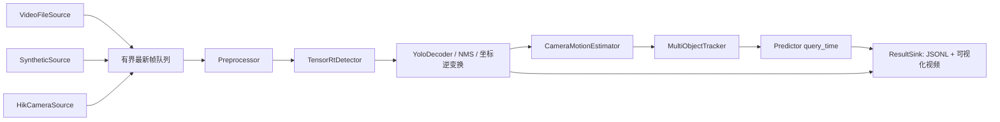

> 已归档的历史草案，2026-11-07 起停止作为实施依据。当前设计为仓库内 docs/FPS_Vision_Tracking_TensorRT_Official_v2.0.md，当前进度见 docs/progress.md。本页路径、硬件及未勾选任务保留作历史记录。

# 高速动态目标视觉跟踪与预测实验平台——设计文档

> 状态：待用户审批 ｜ 日期：2026-11-06  
> 本文曾作为历史方案，不从 `Precision_Vision_TensorRT_Engineering_v2.3.md` 批量改名得来。旧文档只作为被审查的参考，见第 12 节。

## 1. 意图

在 Windows + NVIDIA GPU 上建立一个可复现的计算机视觉研究平台，研究自研机器人这类动态目标的检测、精确定位、运动估计、多目标跟踪和未来位置预测，并量化每一步的误差和延迟。

用户的优先目标是**尽量低的延迟**。但所有算法必须先能用同一份录像反复验证，这样算法之间的比较才可信。

## 2. 目标、非目标、反目标

**目标**

- 第一阶段交付可独立运行的闭环：视频回放 → YOLO → ONNX → TensorRT C++ → 检测可视化。
- 录像回放和实时相机走同一条处理链路，只有取帧来源不同。
- 对任意 `query_time` 输出预测位置和协方差。
- 每帧输出第 7 节规定的结构化结果和各阶段耗时。
- 后续阶段加入运动补偿、IMM、MOT、ReID、关键点定位和持续训练。

**非目标**

- 不承诺具体的精度或延迟数字，一切以实测基线为准。
- 不做永久身份识别，Track ID 只在一次会话内有效。
- 第一版不做分布式训练、Web 服务或多路相机。
- 不控制机器人、机械臂或相机运动。这些由用户现有程序负责。

**反目标（出现即算设计失败）**

- 系统接入游戏进程、截取桌面或游戏画面，或生成键鼠等输入指令。
- 预测结果通过任何接口驱动外部执行机构。若将来需要闭环控制，必须作为新需求单独设计和评审。
- 未经人工审核的伪标签进入训练集。
- 未通过回归门禁的模型自动上线。

## 3. 约束

| 项 | 决定 | 来源 |
|---|---|---|
| 运行平台 | Windows x64 + C++ + TensorRT | 用户 |
| 显卡 | RTX 4060 或更高，按 8GB 显存设计 | 用户（显存为我的假设） |
| 相机 | 海康机器人 MV-CS016-10UC，USB3，全局快门，彩色 | 用户已选 |
| 相机安装 | 固定在小机械臂上，相机会移动 | 用户 |
| 目标 | 自研移动机器人，距离和速度都在变化，具体范围待标定 | 用户 |
| 输入 | 自录视频、合成数据、实验台实时相机 | 用户 |
| 输出 | 只有分析结果、预测、误差指标和可视化 | 用户 |
| 流程 | 用 OpenSpec 制定实施计划，报告用中文 | 用户 |
| 开发机 | 当前是 macOS，无法运行 TensorRT | 现状 |

手机和蓝牙方案已放弃，不进入设计。

## 4. 总体架构



**分层**

- `vision_core`：纯 C++17，不依赖 CUDA、TensorRT 或相机 SDK。包含契约、坐标变换、Kalman/IMM、关联、预测和指标。可在 macOS 和 CI 上编译测试。
- `vision_trt`：TensorRT 引擎加载、推理和 Engine Builder，只在 Windows 构建。
- `vision_camera`：海康 MVS SDK 适配，只在 Windows 构建，且不是第一阶段依赖。
- `apps/`：`env_probe`、`engine_builder`、`replay_runner`、`live_runner`、`eval_report`。

工程放在独立目录 `dynamic-vision/`，与 `TensorRT-11.4/` 并列。平台链接 NVIDIA 官方 Windows SDK，不修改也不编译 `TensorRT-11.4` 源码；该源码只作 API 和示例参考。

**线程**：采集、GPU 推理、跟踪、输出各一个线程。队列有界，默认容量 1–2，队满丢弃最旧帧并计数。回放评估模式改为阻塞、不丢帧，保证结果可复现。

## 5. 单一数据契约

权威文件：`dynamic-vision/include/vision/contracts/Types.hpp`，其他模块不得重复定义。以下草案修复了 v2.3 的缺陷（第 12 节），字段可在实现时细化，但语义不变。

```cpp
namespace vision {
using TimestampNs = int64_t; // 会话内单调纳秒，不是 Unix 时间

struct RectF { float x{}, y{}, w{}, h{}; };   // 原图像素
struct PointF { float x{}, y{}; };
struct Keypoint { uint16_t id{}; PointF xy; float confidence{}; bool visible{}; };

struct ModelIdentity { std::string model_id, engine_id; uint64_t model_epoch{}; };

enum class FocusState { Unknown, Stable, Changing };

struct FrameMeta {
    uint64_t frame_id{};
    FocusState focus_state{FocusState::Unknown}; // 来自录制元数据，平台不触发对焦
    std::string source_id, session_id;
    TimestampNs capture_ns{};   // 相机设备时间映射后的时刻；回放时来自录制元数据
    TimestampNs receive_ns{};   // 主机收到帧的时刻
    int width{}, height{};
    float exposure_us{};
    uint64_t model_epoch{};
};

struct Detection {
    RectF bbox{};
    int class_id{};
    float confidence{};
    std::vector<Keypoint> keypoints;   // 第三阶段启用
    std::optional<std::string> mask_ref;
};

struct Covariance2 { float xx{}, xy{}, yy{}; };

enum class TrackStatus { Tentative, Confirmed, Lost, Removed };

struct TrackSnapshot {
    uint64_t track_id{};
    int class_id{};
    RectF bbox{};
    PointF position{}, velocity_px_per_s{};
    Covariance2 position_cov{};
    TrackStatus status{};
    float confidence{};
    TimestampNs state_ns{};
    std::optional<uint64_t> parent_track_id;
};

enum class PredictionStatus { Ok, HorizonExceeded, UncertaintyExceeded, TrackUnavailable };

struct Prediction {
    uint64_t track_id{};
    TimestampNs query_ns{};
    PointF position{};
    Covariance2 cov{};
    float region_95_major{}, region_95_minor{}, region_95_angle_rad{};
    PredictionStatus status{};
};

struct StageTimings {
    int64_t preprocess_ns{}, upload_ns{}, infer_ns{}, download_ns{},
            decode_nms_ns{}, motion_ns{}, associate_ns{}, predict_ns{}, total_ns{};
};
}
```

**接口**

```cpp
struct ImageView; // 明确像素格式、尺寸、步长、内存位置（host/pinned/device）

class IFrameSource   { virtual std::optional<Frame> next() = 0; };
class IDetector      { virtual Result<std::vector<Detection>> infer(const FrameMeta&, const ImageView&) = 0; };
class ITracker       { virtual std::vector<TrackSnapshot> update(const FrameMeta&, std::span<const Detection>,
                                                                 const CameraMotion&) = 0; };
class IPredictor     { virtual Prediction predict(uint64_t track_id, TimestampNs query_ns) const = 0; };
class IResultSink    { virtual void write(const FrameResult&) = 0; };
```

C++17 没有 `std::span`，实现时用项目内的轻量 span 或 `const vector&`。`IFrameSource` 只有三种实现，见第 8 节。不存在任何向外发送控制量的接口。

**坐标与时间规则**

- 所有对外坐标都是原图像素，左上角为原点。
- `source → crop → letterbox → network → decoded → source` 必须可逆并有测试。
- 关键点、框中心和掩膜质心各自独立定义，不互相替代。
- 关联和预测只用 `capture_ns`，不用推理完成时间。
- 结果的 `model_epoch` 与跟踪器当前 epoch 不一致时直接丢弃并计数。

## 6. 算法设计

**目标远近变化**

- 默认输入 640。评估按目标短边像素分桶：`<16`、`16–32`、`32–96`、`>96`。
- 远处小目标召回不足时，按顺序尝试 960 输入、切片推理、基于轨迹预测的局部放大。是否采用由实测的召回和延迟决定。

**目标快慢变化**

- 基础状态 `[cx, cy, w, h, vx, vy, vw, vh]`，保证 IoU 匹配有预测框可用。
- IMM 三模式：近静止、匀速、机动。
- 过程噪声和测量噪声随目标尺度、置信度调整。

**相机运动**

- 第二阶段的第一步，先于 MOT 完成。
- 默认只用图像：提取背景特征（排除检测框内区域），估计帧间全局变换，把轨迹预测状态变换到当前帧。
- 机械臂带有平移时视差会使单应性失效，须检测并标记 `motion_valid=false`，此时放宽门控。
- `CameraMotion` 预留可选的外部位姿输入，用于将来接入机械臂关节角记录，但第一版不依赖它，平台也不向机械臂发送任何内容。

**多目标跟踪**

- 一个 `MultiObjectTracker` 管理全部轨迹，流程为预测 → 马氏门控 → 匈牙利一对一分配 → 更新/创建/丢失/删除。
- 代价 `α(1-IoU) + βd_motion + γd_appearance`，第三阶段前 `γ=0`。
- 丢失超时按毫秒配置。无法确认身份时开新 ID，不强行保留旧 ID。

**预测**

- `predict` 从轨迹最新状态推演到 `query_ns`，不修改滤波器内部状态。
- 超过最大时域或协方差门槛时返回对应状态，不继续外推。
- 95% 区域由 2×2 协方差的特征分解得到。

**性能**

- 基线稳定后再引入 CUDA Stream 异步、Pinned Memory、缓冲复用，以及 FP16/INT8 对比。
- 每项优化都要在相同精度门禁下做 A/B 测试。

## 7. 输出接口

`ResultSink` 每帧写一行 JSONL，并可选写可视化视频：

- `frame_id`、`capture_ns`、`model_id`、`model_epoch`
- 每个目标：`track_id`、`class_id`、框、关键点、当前位置、速度、协方差
- 指定 `query_ns` 的预测位置、95% 区域和状态
- `StageTimings`
- 队列丢帧数和陈旧结果丢弃数

输出只写文件或本地显示，不提供网络下发或控制通道。

## 8. 输入与数据

| 来源 | 阶段 | 说明 |
|---|---|---|
| `VideoFileSource` | 一 | 自录视频。时间戳来自旁路元数据，缺失时按帧率推算并标记 `timestamp_estimated` |
| `SyntheticSource` | 一/二 | 带精确真值的合成场景，用于算法单测和回归 |
| `HikCameraSource` | 二 | MVS SDK 取 Bayer 8，读取设备时间戳并录制原始帧和元数据 |

**真值来源**

- 合成数据：真值由生成器给出。
- 真实数据：在机器人上贴 AprilTag 作为独立几何参考，用于定位和预测误差评估；人工标注用于检测和 MOT。真值不能由被测模型自身产生。

**数据集规则**

- 每个会话有清单：录制者、设备、时间、来源类型，只接受第 8 节的三种来源。
- 按 `session_id` 划分 train/val/test，同一会话的帧和裁剪不跨分区。
- 冻结测试集不进入训练。
- 不导入旧项目的 `legacy_center320` 样本或任何无来源记录的数据，也不沿用旧权重。

**类别**：初版 `0=robot`，`1=marker`，具体在数据集清单中冻结。关键点定义在第三阶段随模型一起确定。

## 9. 分阶段交付与验收

**阶段 0：环境探针**

- `env_probe` 记录 GPU、驱动、CUDA、TensorRT、MSVC，生成 `config/toolchain.lock.json`。
- 确认实际可链接的库名，含 ONNX 解析插件。
- 用 ADR 记录版本选择，不预设版本。

**阶段 1：最小闭环**

- 流程：合成或录制视频 → YOLO 训练 → ONNX + 模型清单 → Engine Builder → `replay_runner` → 带框视频和 JSONL。
- 验收：
  - 同一输入连续运行结果确定。
  - TensorRT 与 PyTorch 在黄金样本上的差异有记录。
  - 输出 P50/P95/P99 耗时和显存占用基线。
  - `vision_core` 单测全部通过。
  - 交付中文测试报告。

**阶段 2：运动与跟踪**

- 顺序：相机运动补偿 → Kalman → IMM → MOT → 离线预测评估 → 接入实时相机。
- 验收：
  - 合成数据上滤波一致性（NIS）合格。
  - 输出 IDF1、HOTA、ID Switches。
  - 输出按时域和速度分组的 MAE、RMSE。
  - 实测端到端延迟，含一次用 LED 或计时器做的光到结果测量。

**阶段 3：精度与性能**

- ReID、关键点亚像素定位、异步 GPU 流水线、2 小时长稳测试。
- 验收：定位误差相对 AprilTag 或合成真值有报告；优化前后的 A/B 数据完整。

**阶段 4：持续学习**

- 流程：困难样本采集 → 候选标注 → 人工审核 → 不可变数据集版本 → 训练 → 回归评估 → Engine 构建 → 回放对照 → 人工批准切换 → 可回滚。
- 用 SQLite + CLI，不建 Web 服务。
- 单机单路不做 5%/25%/100% 灰度，改用回放对照后整体切换。
- 切换时 `model_epoch` 递增并重建轨迹。
- 种子模型的登记和基线必须先于回归门禁完成。

## 10. 测试策略

| 层 | 内容 | 环境 |
|---|---|---|
| 单元 | 坐标变换、Kalman/IMM、匈牙利、门控、预测状态、队列、epoch 丢弃 | macOS / CI |
| 回放 | 合成序列的端到端回归，用假检测器隔离算法误差 | macOS / CI |
| 集成 | ONNX → Engine → 推理、黄金样本、内存生命周期 | Windows GPU |
| 硬件 | 海康取流、掉帧、拔线恢复、时间戳映射 | 实验台 |
| 边界 | 见下 | CI |

**边界测试**：CI 扫描源码和链接符号，出现以下内容即失败：`SendInput`、`mouse_event`、`keybd_event`、`SetWindowsHookEx`、DXGI Desktop Duplication、`BitBlt` 式桌面截图、游戏进程注入类 API。

## 11. 风险

- **时间戳**：相机设备时钟到主机时钟的映射有漂移，第二阶段需要标定。
- **运动模糊**：曝光过长会同时损害检测和定位，实验台需要足够补光。
- **视差**：机械臂平移时单应性模型失效，只能标记失效，不能假装可靠。
- **USB3 带宽**：线缆和主板接口可能掉帧，第二阶段做长时间测试。
- **依赖许可**：Ultralytics 通常是 AGPL-3.0。研究使用风险较低，若将来闭源或商用，需要重新评估。
- **相机参数**：约 249 fps 等参数来自经销商资料，到货后以官方规格书和实测为准。

## 12. 对旧文档的审查结论

`Precision_Vision_TensorRT_Engineering_v2.3.md` 不再作为实现依据。保留思路：单一契约、Engine 与 Runtime 分离、审核后才入训、回归门禁和回滚。

| v2.3 缺陷 | 本文处理 |
|---|---|
| 启动指令指向不存在的 v2.2 文件 | 本文为唯一基线 |
| `TrackSnapshot` 无类别 | 增加 `class_id` |
| `model_epoch` 不在主数据流 | 进入 `FrameMeta` |
| Kalman 状态无宽高 | 改为 8 维状态 |
| `Detection` 只有矩形框 | 增加关键点和掩膜引用 |
| 无 `query_time` 接口 | 增加 `IPredictor` |
| `void*` 图像参数 | 改为 `ImageView` |
| 运动补偿排在 MOT 评估之后 | 提前到第二阶段第一步 |
| CL-14 门禁早于 CL-18 种子基线 | 种子基线先行 |
| 残留截图、地图、“人”、录屏、控制和 PID 内容 | 全部不沿用 |
| 50 个工作包、灰度发布 | 按五个阶段重排，去掉灰度 |

## 13. 参数由用户自行调整

目标距离和速度范围不预先写死，用户在实验中自己调参。因此：

- 曝光、增益、帧率、ROI、输入尺寸、切片、置信度、NMS、门控、IMM 噪声、丢失超时、预测时域等全部放在 YAML 配置中，改配置不需要重新编译。
- 每次运行把完整生效配置及其哈希写入输出目录，结果才能追溯和对比。
- 配置错误或超出合法范围时启动即报错，不静默修正。
- 交付中文《调参说明》：每个参数的含义、单位、默认值、调大调小的影响、应看哪个指标。
- 默认值只是起点，不是已验证的标准。

## 14. 留给实施者决定

- JSONL 字段的具体命名和版本号。
- 跟踪、输出线程的具体调度方式。
- 第三方库版本，须写入 lock 文件。

## 15. 设计者的默认决定（待用户复核）

- **位置定义**：`TrackSnapshot.position` 默认是框中心。AprilTag 与框中心的偏移先标定，再用于定位评分。
- **真值缺口**：AprilTag 在远距离、小目标或运动模糊时可能识别失败。这些样本在报告中单列为“无几何真值”，不计入定位误差，也不用模型结果补真值。
- **防止模型学标记**：部分录制会话不贴标记，用于检测训练和召回评估。`1=marker` 只在需要时启用，否则只保留 `0=robot`。
- **录制**：`HikCameraSource` 完成前，用海康 MVS 客户端录制原始 Bayer 8 帧，并保存时间戳。训练帧与实时帧走相同的去马赛克和预处理流程。
- **合成数据**：只做简单的 C++ 2D 生成器，用于算法测试，不用于训练可交付模型，也不做渲染场景。
- **阶段 1 验收**：可先用任意授权录制视频跑通，进入阶段 2 前必须在实验台真实录像上复测。
- **小目标手段**：960 输入和切片放在阶段 3 评估。阶段 2 允许远距离检测较弱，但报告必须按尺度分桶写明。轨迹引导的局部放大需要反馈路径，不在当前范围。
- **模型切换**：第一版切换时重启进程，`model_epoch` 主要用于标记和审计。不做同进程热切换，避免 8GB 显存上同时加载两个引擎。

## 16. 待确认问题的默认值

用户回复“任务继续”，未逐项回答，以下按建议值执行。这些是默认值，不是用户已确认的事实，用户可随时修改。

| 问题 | 默认值 | 影响 |
|---|---|---|
| 预测坐标 | 像素，换算到消除相机运动后的参考画面；不做物理坐标 | 保持 2D 滤波，不需要手眼标定和深度估计 |
| 机械臂运动 | 未知。图像法为默认路径，第一次录制起就尽量记录关节角和时间戳 | 若平移为主，运动补偿方案需要重新评估 |
| 硬件 | 未知，假设 Windows GPU 机器由用户操作 | 计划拆成 macOS 可验证的部分，以及交给用户运行的 Windows 包 |
| 目标数量 | 同时 1–3 个，外观可能相同 | ReID 优先级降低，排在关键点定位之后 |
| 结果用途 | 只做屏幕显示和文件记录 | 不提供下发通道 |
| 预测时域 | 每帧输出配置中的固定时域，默认 10、30、100 ms | 决定 JSONL 结构和评估分组 |
| 延迟终点 | 结果写入内存队列的时刻，屏幕延迟另测 | 决定端到端延迟的定义 |

## 17. 目标范围与远距离对焦

用户补充：机器人移动范围有限，通常很小；目标有时离得较远，这时用户会触发对焦后精准拍摄。

**移动范围小**

- “近静止”和小幅移动是主要工况，IMM 必须在这两种工况下稳定，不能把检测噪声当成运动。
- 配置中可设目标最大速度和活动区域，用于跟踪门控。两者都由用户调整，并只作门控，不改写观测结果。
- 活动区域固定时，可尝试相机硬件 ROI，以提高帧率、降低延迟。ROI 必须记录在元数据中，坐标仍换算回全幅原图。
- 预测误差除按时域和速度分组外，增加“近静止”分组，并与“预测位置等于最新观测”的基线对比。

**远距离对焦**

- 对焦由用户或用户现有程序触发，平台不发送对焦或拍摄指令，只记录状态。
- 对焦期间画面会模糊，目标尺寸也可能轻微变化（呼吸效应），这些帧标记为 `FocusState::Changing`。
- 相机模型 MV-CS016-10UC 本身没有自动对焦，需要电动镜头或液体镜头，或者小光圈加大景深。镜头选型须确认能否满足这一点。
- 对焦后的“精准拍摄”帧要能在结果中对应，用于单独评估定位误差。
- `Changing` 帧在阶段 2 放宽检测关联，且不计入稳定工况的误差统计，但单独报告。
- 对焦前后的内参不同。若用到物理量或单应性，需要按对焦位置标定。

## 18. 对焦取消与“目标居中”需求

用户更新：可以不对焦，默认改为固定焦距加大景深，`focus_state` 保留为可选元数据。

用户新增需求：拍照时目标必须在照片中央。

- **不实现**：根据检测或预测结果实时驱动相机、机械臂对准目标，或自动触发拍摄。这属于第 2 节反目标，且不作为本项目的新需求接受。
- **采用方案**：从持续采集的帧中实时筛选最佳照片，见下文。相机不主动追踪目标，不向任何设备发送内容。

**用户的实际目标（2026-11-06 补充）**：拍到清晰照片，目标完整入镜，位于画面三分之一到三分之二之间。

用户要求最佳照片必须实时产出，不接受录制结束后才出图（2026-11-06）。阶段 1 用回放验证，阶段 2 接入相机。默认标准如下，阈值可配置：

- **清晰**：目标框内清晰度得分达标，排除运动模糊帧。
- **完整**：目标框不接触画面边缘，且遮挡判定通过。
- **位置**：框中心的 x、y 都落在画面 1/3 到 2/3 之间。
- **输出**：按可配置时间窗（默认 1000 ms）保存窗口内清晰度最高的合格原始帧，并写出位置和各项得分。输出延迟约等于时间窗。

机械臂可由用户现有程序按预设位姿或路径运动，但该运动不使用本平台的结果。

## 19. 后续路边部署（不在当前计划内）

用户计划：当前目标是自己的机器人，由机械臂带相机拍摄；以后机器人上路，在路边某区域活动并录制和拍摄。

- 当前阶段 0–2 只面向实验台和用户自己的机器人。
- 路边阶段会拍到路人和车辆，其目标、权限和数据处理都与当前设计不同，上路前须单独评审。
- 本项目不包含真实人员的身份识别或定位。旁人的人脸、车牌等个人信息的采集、遮盖和留存，须在该评审中明确。
